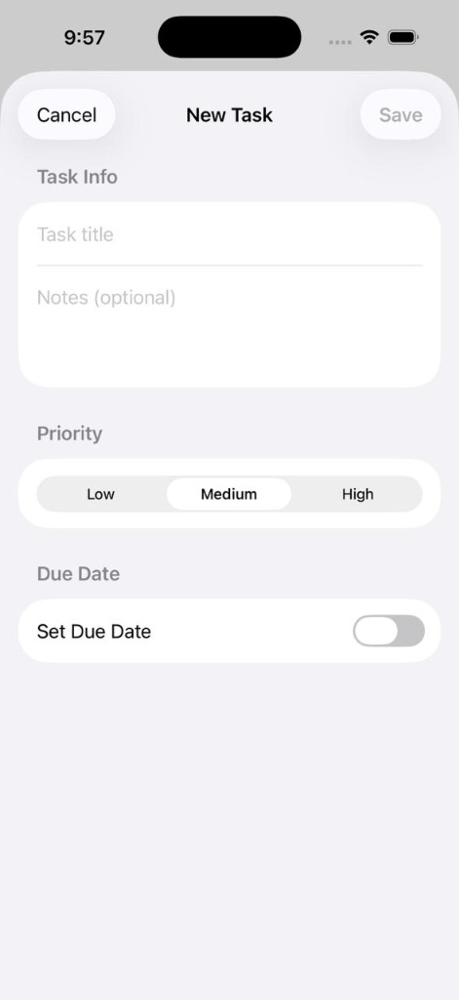
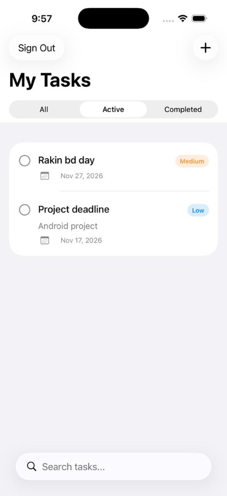
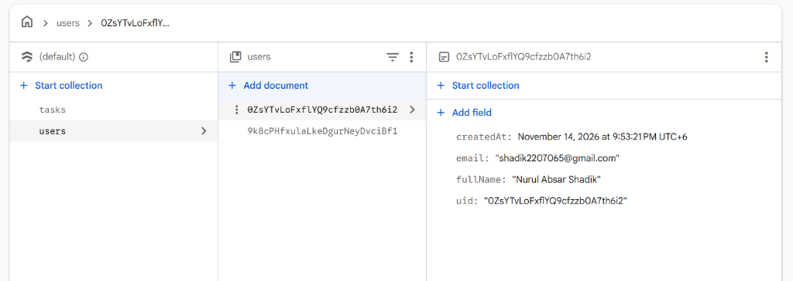
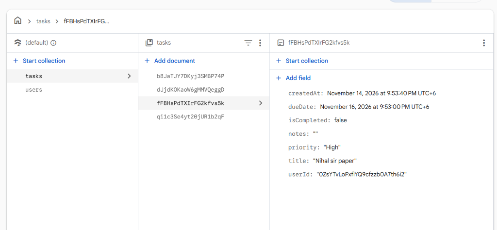
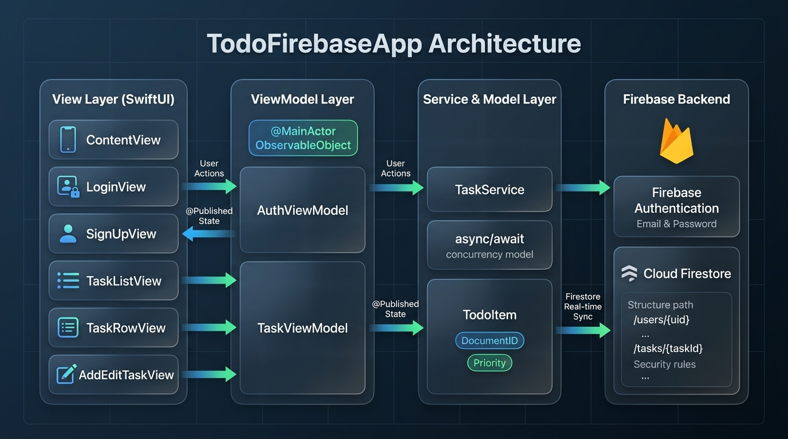
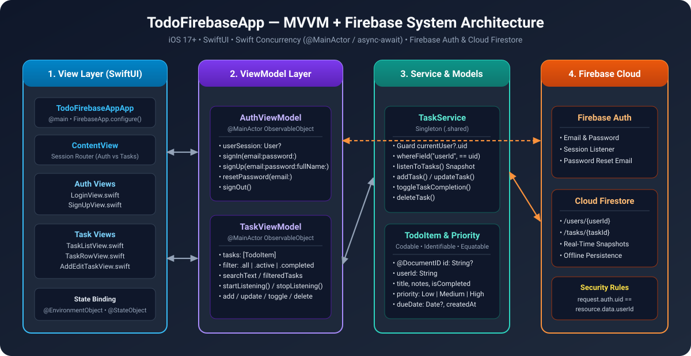
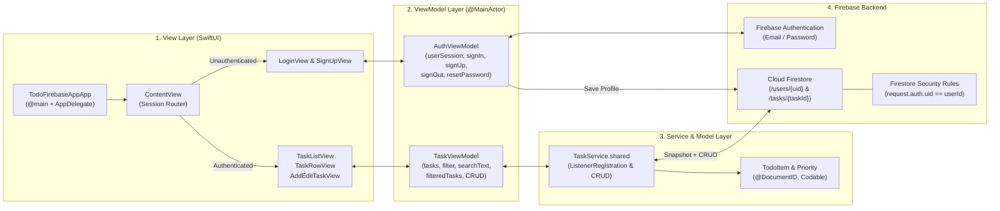
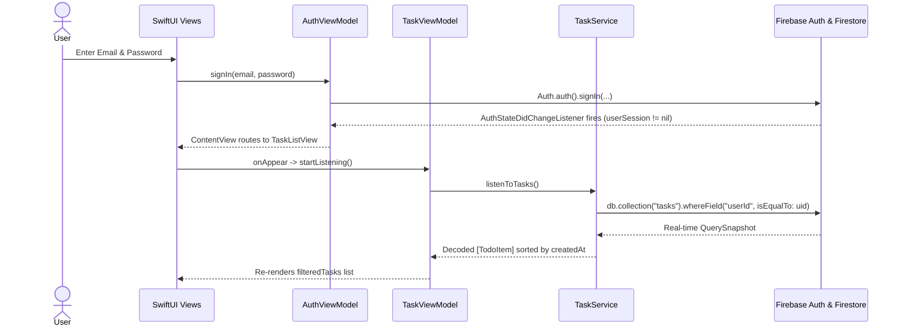

# 📱 TodoFirebaseApp — iOS SwiftUI & Firebase Task Manager

<p align="center">
  
  
  
  
  
</p>

**TodoFirebaseApp** is a native iOS task management application built with **SwiftUI** and **Google Firebase** (`FirebaseAuth` and `FirebaseFirestore`). It follows the **MVVM (Model–View–ViewModel)** pattern using modern Swift Concurrency (`async`/`await` and `@MainActor`) and enforces strict **per-user data isolation** both on the client and via Cloud Firestore Security Rules.

---

## ✨ Key Features

- 🔐 **Email & Password Authentication (`FirebaseAuth`)**
  - User registration with Full Name, Email, and Password validation.
  - Persistent session state listener (`addStateDidChangeListener`) that automatically routes between `LoginView` and `TaskListView`.
  - Built-in **Forgot Password?** email reset flow.
- ☁️ **Real-Time Cloud Sync (`FirebaseFirestore`)**
  - Live Firestore snapshot listener (`addSnapshotListener`) updates the UI immediately whenever tasks are added, edited, completed, or deleted.
  - Automatic user profile creation under `/users/{uid}` upon sign-up.
- 🛡️ **Strict Per-User Data Isolation**
  - Every task document stores its owner's `userId`.
  - Client-side queries filter strictly by `.whereField("userId", isEqualTo: uid)`, and server-side `firestore.rules` verify `request.auth.uid == resource.data.userId`.
- ✅ **Rich Task Management UI**
  - Create and edit tasks with **Title**, **Notes**, **Priority** (`Low`, `Medium`, `High`), and optional **Due Date**.
  - Segmented filter bar (**All**, **Active**, **Completed**) and real-time search bar (`.searchable`).
  - One-tap completion toggle with strikethrough styling, color-coded priority pills, overdue date highlighting, and swipe-to-delete / swipe-to-edit actions.

---

## 📸 App Screenshots

### Authentication & Task Creation
| Sign In Screen (`LoginView`) | Create / Edit Task Sheet (`AddEditTaskView`) |
| :---: | :---: |
|  |  |

### Real-Time Task List & Filtering (`All` • `Active` • `Completed`)
| All Tasks | Active Tasks | Completed Tasks |
| :---: | :---: | :---: |
|  |  |  |

### Cloud Firestore Backend Verification
| `/users/{userId}` Collection | `/tasks/{taskId}` Collection (User-Scoped) |
| :---: | :---: |
|  |  |

---

## 🏗️ System Architecture

<p align="center">
  
</p>

<details>
<summary><b>🔍 View Vector SVG Architecture Diagram</b></summary>
<br />
<p align="center">
  
</p>
</details>

### Architectural Flow (Mermaid Diagram)



### Authentication & Real-Time Firestore Sequence



---

## 📂 Project Directory Structure

```text
To-Do-App/
├── .gitattributes                         # Enforces Unix LF line endings across Windows & macOS
├── .gitignore                             # Standard Xcode & SwiftPM ignore rules
├── firestore.rules                        # Production per-user Cloud Firestore security rules
├── docs/
│   └── images/                            # App screenshots & architecture diagrams
├── TodoFirebaseApp.xcodeproj/             # Native Xcode 16 project bundle
│   ├── project.pbxproj
│   └── project.xcworkspace/
└── TodoFirebaseApp/
    ├── App/
    │   └── TodoFirebaseAppApp.swift       # @main entry point & FirebaseApp.configure()
    ├── ContentView.swift                  # Root view switching between LoginView & TaskListView
    ├── Models/
    │   └── TodoItem.swift                 # TodoItem struct (@DocumentID) & Priority enum
    ├── ViewModels/
    │   ├── AuthViewModel.swift            # Firebase Auth state & user session management
    │   └── TaskViewModel.swift            # Task state, search, filtering & CRUD actions
    ├── Views/
    │   ├── Auth/
    │   │   ├── LoginView.swift            # Email/Password login & password reset alert
    │   │   └── SignUpView.swift           # Account creation with form validation
    │   └── Tasks/
    │       ├── TaskListView.swift         # Main task list, filter picker, search & sheets
    │       ├── TaskRowView.swift          # Task row with checkbox, priority badge & due date
    │       └── AddEditTaskView.swift      # Form sheet for adding and editing tasks
    ├── Services/
    │   └── TaskService.swift              # User-scoped Firestore listener & CRUD operations
    ├── Assets.xcassets/                   # AppIcon and AccentColor catalogs
    ├── Preview Content/                   # Preview Assets catalog
    └── GoogleService-Info.plist           # Firebase iOS configuration file
```

---

## 🔒 Data Model & Security Rules

### `TodoItem` Schema (`tasks` Collection)

| Field | Type | Description |
| :--- | :--- | :--- |
| `id` | `String?` (`@DocumentID`) | Auto-generated Firestore document ID |
| `userId` | `String` | Firebase Auth `uid` of the task owner |
| `title` | `String` | Task title (required) |
| `notes` | `String` | Optional multi-line description |
| `isCompleted` | `Bool` | Completion status (`true` / `false`) |
| `priority` | `String` (`Priority`) | `"Low"`, `"Medium"`, or `"High"` |
| `dueDate` | `Timestamp?` (`Date?`) | Optional scheduled due date |
| `createdAt` | `Timestamp` (`Date`) | Creation timestamp used for sorting |

### Firestore Security Rules ([firestore.rules](firestore.rules))

```javascript
rules_version = '2';

service cloud.firestore {
  match /databases/{database}/documents {
    match /users/{userId} {
      allow read, write: if request.auth != null && request.auth.uid == userId;
    }

    match /tasks/{taskId} {
      allow read, update, delete: if request.auth != null
                                  && request.auth.uid == resource.data.userId;

      allow create: if request.auth != null
                    && request.auth.uid == request.resource.data.userId;
    }
  }
}
```

---

## 🚀 Getting Started

### Prerequisites
- **macOS** with **Xcode 16.0+** (or Xcode 15.2+)
- **iOS 17.0+** Simulator or physical iPhone
- A **Firebase project** with **Email/Password Authentication** and **Cloud Firestore** enabled

### Installation & Running in Xcode

1. **Clone the repository:**
   ```bash
   git clone https://github.com/failuresoul/To-Do-App.git
   cd To-Do-App
   ```

2. **Configure Firebase (`GoogleService-Info.plist`):**
   - In the [Firebase Console](https://console.firebase.google.com/), register an iOS app with Bundle ID **`com.example.TodoFirebaseApp`**.
   - Download `GoogleService-Info.plist` and place it at `TodoFirebaseApp/GoogleService-Info.plist`.
   - Enable **Authentication → Sign-in method → Email/Password**.
   - Create a **Cloud Firestore** database and publish the rules from [`firestore.rules`](firestore.rules).

3. **Open and Run in Xcode:**
   ```bash
   open TodoFirebaseApp.xcodeproj
   ```
   - Wait for Xcode to finish resolving Swift Package Manager dependencies (`firebase-ios-sdk`).
   - Select an iPhone simulator (e.g., **iPhone 16**) and press **`Cmd + R`**.

> 💡 **Lab Mac Tip:** If Xcode shows `Could not create workspace arena folder`, go to **Xcode → Settings → Locations → Derived Data → Advanced…** and select **Relative to Workspace** (or a custom folder in `/tmp/DerivedData`).

---

## 👤 Author

**Nurul Absar Shadik**  
GitHub: [@failuresoul](https://github.com/failuresoul)
