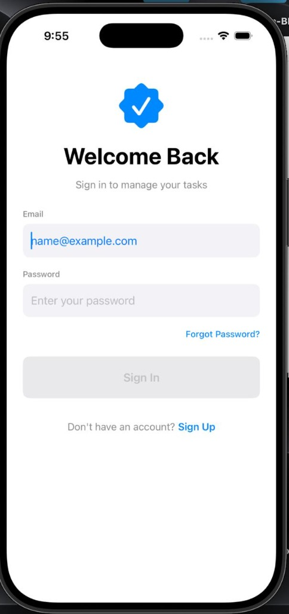
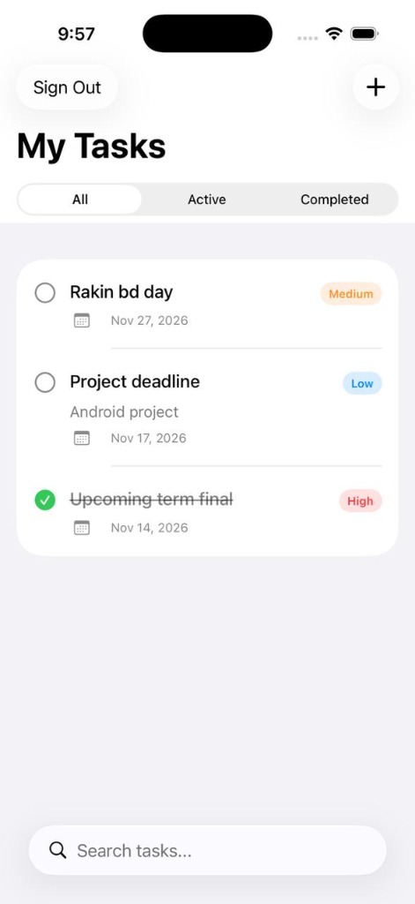
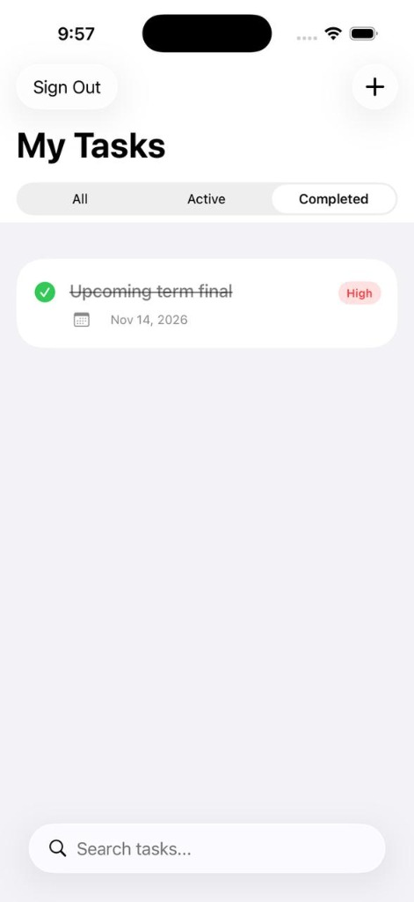

# 📱 TodoFirebaseApp — iOS SwiftUI & Firebase Task Manager

<p align="center">
  
  
  
  
  
</p>

## 📖 Overview

**TodoFirebaseApp** is a native iOS task management application built with **SwiftUI** and **Google Firebase** (`FirebaseAuth` and `FirebaseFirestore`). The app allows users to create an account, sign in securely, and manage their personal daily tasks in real time.

Every task is tied to the logged-in user's unique Firebase `uid`, ensuring that each user can only view, create, edit, complete, or delete their own tasks.

---

## 📑 Table of Contents

1. [System Architecture](#-1-system-architecture)
2. [How the App Works (Layer-by-Layer Description)](#-2-how-the-app-works-layer-by-layer-description)
3. [Core Features](#-3-core-features)
4. [Database Design & Security Rules](#-4-database-design--security-rules)
5. [Project Folder & File Structure](#-5-project-folder--file-structure)
6. [App Screenshots & Firebase Verification](#-6-app-screenshots--firebase-verification)
7. [How to Set Up & Run in Xcode](#-7-how-to-set-up--run-in-xcode)
8. [Author](#-8-author)

---

## 🏗️ 1. System Architecture

The project uses the **MVVM (Model–View–ViewModel)** architecture combined with a dedicated **Service Layer** and **Firebase Cloud Backend**. This keeps the user interface clean and separates UI code from Firebase database logic.

<p align="center">
  
</p>

---

## 🧩 2. How the App Works (Layer-by-Layer Description)

### Layer 1: View Layer (`SwiftUI`)
The View Layer only handles what the user sees on screen and sends button taps to the ViewModels:
- **`TodoFirebaseAppApp.swift`**: The main entry point (`@main`) of the app. It initializes Firebase using `FirebaseApp.configure()` and creates a shared `AuthViewModel` for the entire app.
- **`ContentView.swift`**: Acts as the session router. It checks `authViewModel.userSession`:
  - If no user is signed in (`nil`), it shows **`LoginView`**.
  - If a user is signed in, it automatically transitions to **`TaskListView`**.
- **`LoginView.swift` & `SignUpView.swift`**: Clean iOS forms for signing in, registering a new account with password validation, and sending password reset emails.
- **`TaskListView.swift`**: Displays the segmented filter bar (`All`, `Active`, `Completed`), the search bar, the list of tasks, empty-state messages, a `Sign Out` button, and a `+` button to add new tasks.
- **`TaskRowView.swift`**: Displays a single task row with a completion checkbox button, task title (with strikethrough when completed), notes preview, color-coded priority badge (`Low`, `Medium`, `High`), and formatted due date.
- **`AddEditTaskView.swift`**: A sheet form used both for creating a new task and editing an existing task.

---

### Layer 2: ViewModel Layer (`@MainActor ObservableObject`)
The ViewModels hold the screen state (`@Published` properties) and connect the UI to Firebase:
- **`AuthViewModel.swift`**:
  - Listens to Firebase's authentication state using `Auth.auth().addStateDidChangeListener`.
  - Provides `signIn(email:password:)`, `signUp(email:password:fullName:)`, `resetPassword(email:)`, and `signOut()`.
  - When a new user signs up, it also saves their profile document (`uid`, `fullName`, `email`, `createdAt`) inside the Firestore `users` collection.
- **`TaskViewModel.swift`**:
  - Stores the live array of `tasks: [TodoItem]`, the active `filter` (`All`, `Active`, `Completed`), and `searchText`.
  - Computes `filteredTasks` automatically whenever the user switches tabs or types in the search bar.
  - Calls `TaskService` to start/stop the real-time listener and perform add, update, toggle completion, and delete actions.

---

### Layer 3: Service & Model Layer (`Services/` & `Models/`)
- **`TodoItem.swift`**:
  - Defines the `TodoItem` struct conforming to `Identifiable`, `Codable`, and `Equatable`.
  - Uses `@DocumentID var id: String?` so Firestore automatically maps each document's ID.
  - Defines the `Priority` enum (`Low`, `Medium`, `High`).
- **`TaskService.swift`**:
  - Handles all communication with the Firestore `"tasks"` collection.
  - Checks `guard let uid = Auth.auth().currentUser?.uid else { return }` before every request.
  - Queries only tasks belonging to the current user: `.whereField("userId", isEqualTo: uid)`.
  - Uses `addSnapshotListener` so any change in Firestore immediately updates the app UI in real time.

---

### Layer 4: Firebase Cloud Backend
- **Firebase Authentication**: Manages user accounts, password hashing, session tokens, and password reset emails.
- **Cloud Firestore**: NoSQL cloud database storing two collections:
  1. `users`: Stores user profile details indexed by `uid`.
  2. `tasks`: Stores all to-do items with a `userId` field linking each task to its owner.

---

## ✨ 3. Core Features

| Feature | Description |
| :--- | :--- |
| **User Authentication** | Sign up with Full Name, Email, and Password (6+ character check & password confirmation). |
| **Persistent Session** | Users stay logged in across app restarts until they tap **Sign Out**. |
| **Password Recovery** | **Forgot Password?** alert sends a reset link directly to the user's email. |
| **Create & Edit Tasks** | Add a title, multi-line notes, priority level (`Low`, `Medium`, `High`), and an optional due date. |
| **Real-Time Sync** | Tasks update live across devices via Cloud Firestore snapshot listeners. |
| **Filter & Search** | Filter tasks by **All**, **Active**, or **Completed**, and search by title or notes. |
| **Swipe Actions** | Swipe left on any task row to **Delete** or **Edit**, or tap the circle icon to mark complete. |
| **User Isolation** | Users can only access their own tasks—enforced in both Swift code and Firestore Security Rules. |

---

## 🔒 4. Database Design & Security Rules

### Collection 1: `users/{userId}`
Created automatically when a user registers in `SignUpView`.

| Field | Type | Example Value |
| :--- | :--- | :--- |
| `uid` | `String` | `"0ZsYTvLoFxflYQ9cfzzb0A7th6i2"` |
| `fullName` | `String` | `"Nurul Absar Shadik"` |
| `email` | `String` | `"shadik2207065@gmail.com"` |
| `createdAt` | `Timestamp` | `November 14, 2026 at 9:53:21 PM UTC+6` |

### Collection 2: `tasks/{taskId}`
Created and updated via `TaskService`.

| Field | Type | Example Value |
| :--- | :--- | :--- |
| `title` | `String` | `"Nihal sir paper"` |
| `notes` | `String` | `"Android project"` |
| `isCompleted` | `Boolean` | `false` |
| `priority` | `String` | `"High"` (`"Low"` \| `"Medium"` \| `"High"`) |
| `dueDate` | `Timestamp?` | `November 16, 2026 at 9:53:00 PM UTC+6` |
| `createdAt` | `Timestamp` | `November 14, 2026 at 9:53:40 PM UTC+6` |
| `userId` | `String` | `"0ZsYTvLoFxflYQ9cfzzb0A7th6i2"` |

### Firestore Security Rules (`firestore.rules`)
These rules run on Google's servers and guarantee that a user can never read, edit, or delete another user's tasks:

```javascript
rules_version = '2';

service cloud.firestore {
  match /databases/{database}/documents {
    // Users can only read and write their own profile document
    match /users/{userId} {
      allow read, write: if request.auth != null && request.auth.uid == userId;
    }

    // Users can only read, create, update, and delete tasks where userId matches their UID
    match /tasks/{taskId} {
      allow read, update, delete: if request.auth != null
                                  && request.auth.uid == resource.data.userId;

      allow create: if request.auth != null
                    && request.auth.uid == request.resource.data.userId;
    }
  }
}
```

---

## 📂 5. Project Folder & File Structure

```text
To-Do-App/
├── .gitattributes                         # Keeps Unix (LF) line endings for Xcode compatibility
├── .gitignore                             # Ignores Xcode build artifacts and user data
├── firestore.rules                        # Cloud Firestore security rules
├── README.md                              # Project documentation
├── docs/
│   └── images/                            # Architecture diagrams and app screenshots
├── TodoFirebaseApp.xcodeproj/             # Native Xcode 16 project configuration
│   ├── project.pbxproj
│   └── project.xcworkspace/
└── TodoFirebaseApp/
    ├── App/
    │   └── TodoFirebaseAppApp.swift       # App entry point & FirebaseApp.configure()
    ├── ContentView.swift                  # Switches between LoginView and TaskListView
    ├── Models/
    │   └── TodoItem.swift                 # TodoItem model and Priority enum
    ├── ViewModels/
    │   ├── AuthViewModel.swift            # Handles sign-in, sign-up, sign-out & session state
    │   └── TaskViewModel.swift            # Manages task list, filtering, search & CRUD calls
    ├── Views/
    │   ├── Auth/
    │   │   ├── LoginView.swift            # Sign-in UI and Forgot Password dialog
    │   │   └── SignUpView.swift           # Registration UI with form validation
    │   └── Tasks/
    │       ├── TaskListView.swift         # Main task screen with filter tabs and search bar
    │       ├── TaskRowView.swift          # Individual task item row with priority badge
    │       └── AddEditTaskView.swift      # Sheet form to create or edit a task
    ├── Services/
    │   └── TaskService.swift              # Firestore snapshot listener and CRUD operations
    ├── Assets.xcassets/                   # AppIcon and AccentColor assets
    ├── Preview Content/                   # Preview assets for Xcode Canvas
    └── GoogleService-Info.plist           # Firebase configuration file
```

---

## 📸 6. App Screenshots & Firebase Verification

### 6.1 Authentication & Creating a New Task
- **Left (`LoginView`):** Clean sign-in screen with Email, Password, Forgot Password alert, and navigation link to Sign Up.
- **Right (`AddEditTaskView`):** Modal sheet for adding a new task with Title, Notes, Priority selector (`Low`, `Medium`, `High`), and optional Due Date toggle.

| Sign In Screen (`LoginView`) | New Task Sheet (`AddEditTaskView`) |
| :---: | :---: |
|  |  |

---

### 6.2 Task Management & Real-Time Filtering (`All` • `Active` • `Completed`)
- **All Tab:** Displays every task for the signed-in user, showing active tasks alongside completed tasks (with green checkmarks and strikethrough text).
- **Active Tab:** Filters the list to show only incomplete tasks that still need attention.
- **Completed Tab:** Filters the list to show only finished tasks.

| All Tasks (`All`) | Active Tasks (`Active`) | Completed Tasks (`Completed`) |
| :---: | :---: | :---: |
|  |  |  |

---

### 6.3 Firebase Cloud Firestore Database Verification
- **Users Collection (`/users`):** Shows the registered user document matching the authenticated `uid`.
- **Tasks Collection (`/tasks`):** Shows task documents linked to the owner via the `userId` field.

#### `users` Collection in Firebase Console
<p align="center">
  
</p>

#### `tasks` Collection in Firebase Console
<p align="center">
  
</p>

---

## 🚀 7. How to Set Up & Run in Xcode

### Step 1: Clone the Repository on macOS
Open **Terminal** on your Mac and run:
```bash
git clone https://github.com/failuresoul/To-Do-App.git
cd To-Do-App
```

### Step 2: Firebase Configuration
1. Go to the [Firebase Console](https://console.firebase.google.com/) and create or open your Firebase project.
2. Register an iOS app with Bundle ID **`com.example.TodoFirebaseApp`**.
3. Download **`GoogleService-Info.plist`** and place it inside the `TodoFirebaseApp/` folder.
4. Under **Security → Authentication → Sign-in method**, enable **Email/Password**.
5. Under **Databases & Storage → Firestore Database**, create a database and publish the rules from [`firestore.rules`](firestore.rules).

### Step 3: Open and Run in Xcode
1. Open the project in Xcode:
   ```bash
   open TodoFirebaseApp.xcodeproj
   ```
2. Wait for Xcode to finish downloading the **Firebase Swift Packages** (`firebase-ios-sdk`).
3. Select an iPhone simulator (such as **iPhone 16**) from the top toolbar.
4. Press **`Cmd + R`** to build and launch the app.

> 💡 **Troubleshooting on Shared/Lab Macs:**  
> If Xcode shows `Could not create workspace arena folder`, open **Xcode → Settings → Locations → Derived Data → Advanced…** and select **Relative to Workspace** (or set a custom path such as `/tmp/DerivedData`).

---

## 👤 8. Author

**Nurul Absar Shadik**  
- GitHub: [@failuresoul](https://github.com/failuresoul)
- Repository: [github.com/failuresoul/To-Do-App](https://github.com/failuresoul/To-Do-App)
